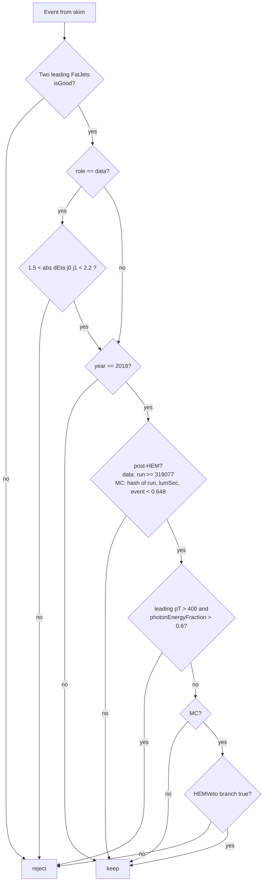
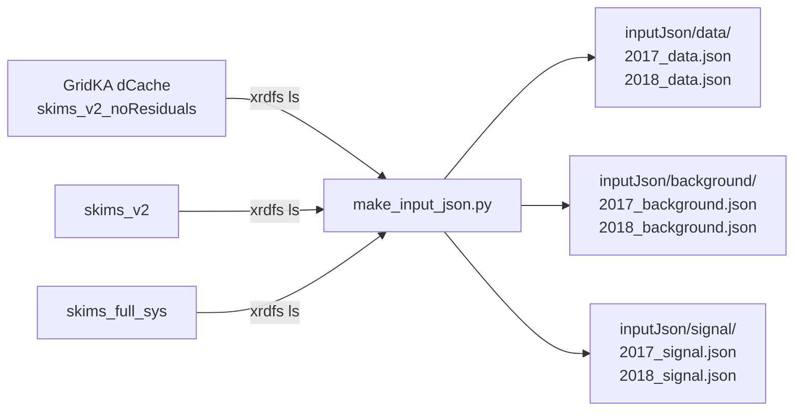
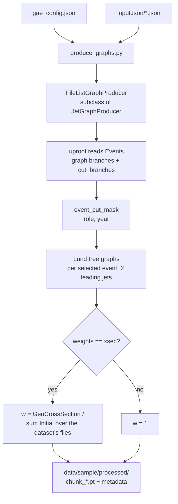
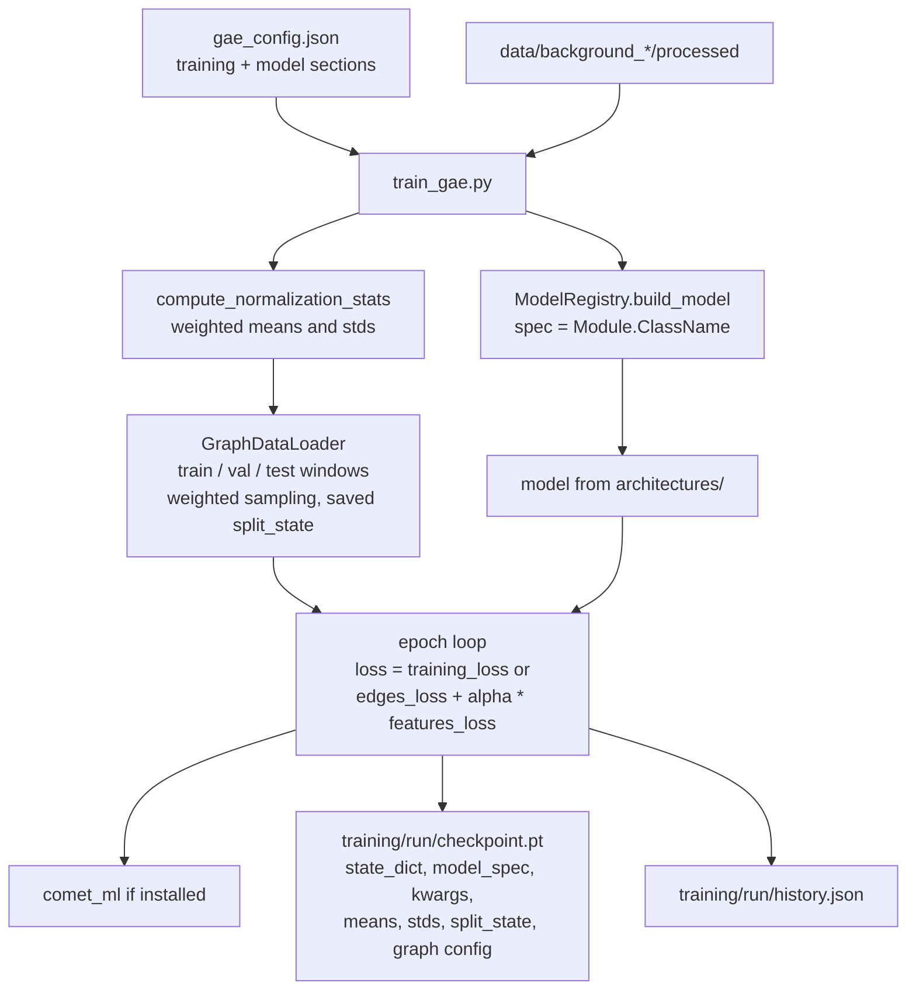
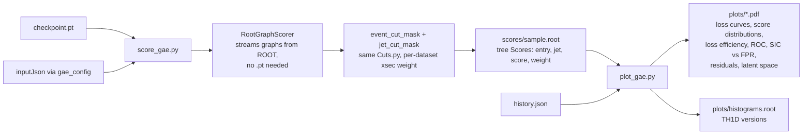
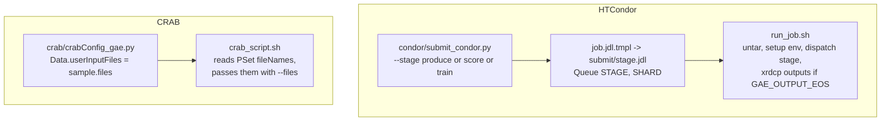

# GAE pipeline: summary of changes

This note summarises the graph autoencoder (GAE) pipeline added to `SVJ_GNN/`,
the changes made on top of the pre-existing modules, and how data processing and
model training now work.

## 1. What was done

### Skeleton pipeline (first iteration)

A model-agnostic pipeline was built around the existing modules
(`JetGraphProducer`, `GraphDataLoader`, `graphAE`, `RootGraphScorer`,
`PlotUtils`). No existing code was rewritten; new functions and subclasses were
appended to existing files and new command line scripts were added. Everything
lives directly in `SVJ_GNN/` and is driven by one JSON configuration,
`gae_config.json`.

| Area | Added |
|---|---|
| Configuration | `gae_config.json`, `utils/GaeConfig.py` |
| Selections | `utils/Cuts.py` |
| Inputs | `utils/InputJson.py`, `make_input_json.py`, `inputJson/` |
| Graph production | `FileListGraphProducer` appended to `utils/JetGraphProducer.py`, `produce_graphs.py` |
| Model registry | `architectures/ModelRegistry.py` |
| Training | `train_gae.py`, `compute_normalization_stats` appended to `utils/LundTreeUtilities.py` |
| Scoring | `score_gae.py` |
| Metrics and plots | `utils/MetricUtils.py`, CMS-style functions appended to `utils/PlotUtils.py`, `plot_gae.py` |
| Batch | `condor/` (HTCondor), `crab/` (CRAB `scriptExe`) |
| Environment | `setup_gae_env.sh`, `requirements-gae.txt` (comet-ml only) |
| Tests and docs | `tests/test_gae_pipeline.py` (32 tests), README section |

### Second iteration: real selections and JSON inputs

- `utils/Cuts.py` went from a pass-through placeholder to the actual analysis
  selections, applied identically in production and scoring.
- Text file lists were replaced by `inputJson/<type>/<year>_<type>.json`,
  generated from the GridKA dCache with `xrdfs`.
- Cross section weights are now normalised per dataset (sum of
  `CutFlow/Initial` over all files of a dataset), and the sums are cached so
  each file is opened once for this purpose.
- Both CLIs gained `--files` so a CRAB job processes only its own files while
  the sample's JSON stays intact for the weights.

## 2. Selections (`utils/Cuts.py`)

All samples go through `event_cut_mask(events, role, year)`; the branches it
needs come from `cut_branches(role, year)`.



Notes:

- The Δη control region is applied to data only, since that is the region the
  autoencoder is trained on.
- The pre/post-HEM assignment of a 2018 MC event is a deterministic function of
  `(run, lumSec, event)`, so production, scoring and any sharding agree without
  a shared random state. `POST_HEM_FRACTION = 0.648` (≈ 38.7 / 59.8 fb⁻¹).
- The 2018 data skims already contain the HEM veto; only MC needs the
  `HEMVeto` branch.
- Changing anything in `Cuts.py` changes `cuts_fingerprint()`, which is stored
  in the processed dataset metadata, so stale graph caches are rejected.

## 3. Inputs (`inputJson/`)



Each JSON groups files by dataset:

```json
{
  "year": "2018",
  "type": "background",
  "base": "root://.../nominal/",
  "datasets": {
    "QCD_HT1000to1500": ["root://.../part-0.root", "..."],
    "TTJets_HT-600to800": ["..."]
  }
}
```

Background is filtered to `QCD_*`, `TTJets_*`, `WJetsToLNu_*`, `ZJetsToNuNu_*`
because the MC area also holds `Run*` and `s-channel*` directories. Only 2017
and 2018 are listed; 2016 background skims lack the scouting collections.

Current contents: 2017 data 1583 files, 2018 data 1405, 2017 background 1756
(21 datasets), 2018 background 2099, 2017 signal 435 (32 points), 2018 signal
331 (33 points).

A sample in `gae_config.json` refers to one JSON:

```json
"background_2018": {
  "role": "background",
  "year": "2018",
  "input_json": "inputJson/background/2018_background.json",
  "weights": "xsec",
  "label": 0
}
```

An optional `"datasets": ["QCD_HT2000toInf"]` restricts the sample to some of
the datasets inside the JSON. `inputJson/smoke/2018_data.json` points at the
local `part-14.root` (2018 data) for quick checks.

## 4. Data processing



Per file the producer:

1. reads the graph-building branches plus `cut_branches(role, year)`;
2. applies `event_cut_mask`; only surviving events are turned into graphs
   (one graph per stored jet, 9 node features: kT, Δ, z, ψ, mass and four
   energy fractions);
3. attaches `w` when `weights == "xsec"`, using the dataset the file belongs
   to (looked up in `dataset_groups`) rather than the whole input list;
4. writes chunked `.pt` files whose metadata records the graph configuration,
   the role, the year, the cuts fingerprint and a hash of the input files.

Sharding for batch jobs: `--files-per-job N --shard i` processes the *i*-th
contiguous block of N files; `--files a.root b.root` processes an explicit
subset (used by CRAB).

## 5. Model training



- The training sample defaults to every `background` role sample; `--train-on`
  selects others (for example the data control region `data_2018`).
- The model is never named in the pipeline. `gae_config.json` holds
  `"spec": "GraphAE.graphAE"` and constructor `kwargs`; a new architecture is a
  new file in `architectures/` plus a one line change. A model must provide
  `forward` and `score_batch`, and either `training_loss(batch, alpha)` or
  `edges_loss` and `features_loss`.
- Normalisation statistics, the split state and the graph configuration are
  stored in the checkpoint so scoring reproduces exactly the training setup.

## 6. Scoring and plots



Plots use mplhep CMS style and are saved as PDF only; the TH1 versions are
written with ROOT. ROC and SIC plots need both a signal and a background sample
with scores.

## 7. Batch submission



Production and scoring are one job per shard of a sample's files. Training is a
single (optionally GPU) HTCondor job; it is deliberately not a CRAB workflow.

## 8. Verification performed

- 32 unit tests in `tests/test_gae_pipeline.py` pass (cuts, input JSON, model
  registry, metrics, configuration, producer helpers).
- Smoke chain on `part-14.root` (2018 data): 582 of 3600 events in the Δη
  control region → 1164 graphs; training, scoring (1164 jets) and plotting all
  run; production and scoring select the same events.
- Remote 2018 QCD and signal files: all events pass isGood, ≈ 0.64 assigned
  post-HEM, `HEMVeto` applied only to that fraction, final efficiency 0.90 (QCD)
  and 0.95 (signal).
- `graph.w` equals `GenCrossSection / Σ Initial` for a remote signal dataset
  (with `--max-events` the base class scales the weight by
  `total_events / events_to_process`, as before).
- `condor/submit_condor.py` shards `signal_2018` correctly from the JSON.

## 9. Points to confirm

1. `POST_HEM_FRACTION = 0.648`.
2. The extended gap-jet veto is applied to post-HEM events in both data and
   MC.
3. `FatJet_isGood` is an event-level requirement on the two leading jets.
4. The MC pre/post-HEM split is fixed per event by hashing
   `(run, lumSec, event)` rather than by a seeded RNG stream.
