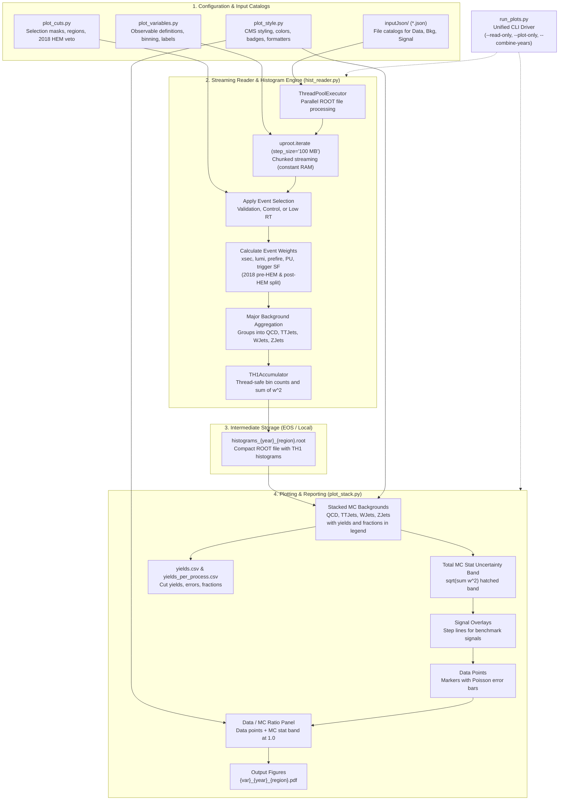

# SVJ_GNN Plotting Framework

A modular, memory-efficient framework for producing publication-quality Data/MC comparison stack plots with ratio panels from ROOT skims using `uproot`, `mplhep` (CMS style), and ROOT `TH1` histograms.

---

## Architecture & Data Flow



---

## Module Breakdown

| Module | Purpose |
|---|---|
| [`plot_variables.py`](plot_variables.py) | **Observable Registry**: Central dictionary `VARIABLES` specifying tree branch names, binning edges, LaTeX axis labels, and log/linear scaling. Contains extraction helpers for both flat branches and jagged collections (e.g. `FatJet1_pt`, `FatJet2_eta`). |
| [`plot_cuts.py`](plot_cuts.py) | **Event Selection**: Builds boolean masks via `get_event_selection(events, role, year, region, period)`. Handles selection regions (`validation`, `control`, `lowRT`, `inclusive`) and complete 2018 HEM conditions (deterministic MC split, data run cut `run >= 319077`, post-HEM gap-jet veto, and `HEMVeto`). |
| [`plot_style.py`](plot_style.py) | **Beautifier & CMS Styling**: Initializes `mplhep.style.CMS`, typography, palettes (`QCD`, `TTJets`, `WJets`, `ZJets`), and legend formatting. Adds CMS header (`CMS Preliminary` when Data is present, `CMS Simulation Preliminary` when Data is omitted). |
| [`hist_reader.py`](hist_reader.py) | **Streaming I/O & TH1 Generator**: Reads ROOT files concurrently via `ThreadPoolExecutor` and streams chunks with `uproot.iterate`. Computes exact physics weights, merges background sub-datasets into major families, and saves/loads compact `TH1` histograms to `.root` files. |
| [`plot_stack.py`](plot_stack.py) | **Stack & Ratio Plotter**: Produces stacked background plots with total MC uncertainty bands, signal overlays, and Data/MC ratio panels. Displays process yields and fractions in the legend and exports `yields.csv` and `yields_per_process.csv`. |
| [`cutflow.py`](cutflow.py) | **Cutflow CLI**: Computes and exports cutflow tables combining ROOT `CutFlow` skim tree steps with additional analysis selection steps, outputting to CSV and printing ASCII summaries. |
| [`run_plots.py`](run_plots.py) | **CLI Orchestrator**: User-facing entry point supporting reading + plotting, `--read-only`, `--plot-only`, `--cutflow`, worker thread control, and multi-year combinations (`Run2`). |

---

## Memory Scaling & Threading

### Constant Memory Footprint
Unlike legacy scripts that load all events into memory (`np.concatenate`), `hist_reader.py` uses an **accumulator pattern**:
1. Files are iterated in chunks of `--step-size 100 MB`.
2. Each chunk is filtered through selections, weighted, and used to increment bin counts and sum of squared weights:
   $$H_{\text{counts}} \leftarrow H_{\text{counts}} + \sum w_i, \quad H_{\text{sumw2}} \leftarrow H_{\text{sumw2}} + \sum w_i^2$$
3. The chunk is released immediately by Python's garbage collector.
4. Total memory usage remains constant (~200–500 MB) regardless of how many files or events are processed.

### Parallel File Reading
`hist_reader.py` processes multiple ROOT files concurrently using Python's `ThreadPoolExecutor(max_workers=args.workers)`. Each thread accumulates into a thread-local dictionary of `TH1Accumulator` objects, which are thread-safely merged upon completion into the target background family or data histogram.

---

## Background Grouping (Major Backgrounds)

Sub-datasets listed in `inputJson/background/{year}_background.json` are aggregated directly into four major families:
- **`QCD`**: all `QCD_HT*` sub-datasets.
- **`TTJets`**: `TTJets_TuneCP5` and `TTJets_HT-*`.
- **`WJets`**: `WJetsToLNu_HT-*`.
- **`ZJets`**: `ZJetsToNuNu_HT-*`.

**Exact Physics Normalization**: Each sub-dataset is scaled by its own cross-section and sum of initial events before merging into the family histogram:
$$\text{scale} = \frac{\sigma_{\text{sub}} \times 10^3}{N_{\text{initial, sub}}} \times k_{\text{factor}}$$

---

## 2018 HEM Veto & Year Combinations

### 2018 HEM Treatment
Total 2018 luminosity ($59.74\text{ fb}^{-1}$) is partitioned into:
- **Pre-HEM period** ($L_{\text{pre}} = 21.1\text{ fb}^{-1}$): No HEM veto is applied.
- **Post-HEM period** ($L_{\text{hem}} = 38.64\text{ fb}^{-1}$):
  - In Data: `run >= 319077`.
  - In MC: deterministic event hash (`_uniform_from_event_id < 0.648`).
  - Extended gap-jet veto on leading FatJet ($p_{\text{T}} > 400\text{ GeV}$, $\text{PEF} > 0.6$).
  - Post-HEM `HEMVeto` requirement for MC.
- Both periods are weighted by their respective luminosities and added together to obtain the correct 2018 total yield.

### Run 2 Combination
When running `--years 2016 2017 2018 --combine-years` or `--years Run2`, each year is processed with its own luminosity, conditions, and vetoes. Histograms are summed bin-by-bin ($H_{\text{Run2}} = \sum_y H_y$) and plotted with $L = 138.0\text{ fb}^{-1}$.

---

## CLI Usage Examples

### 1. Environment Setup
```bash
source init.sh
export PYTHONPATH="SVJ_GNN:${PYTHONPATH}"
```

### 2. Full Run (Read Skims + Generate Plots + Export CSV)
```bash
# Process 2018 validation region with 8 worker threads
python SVJ_GNN/plotting/run_plots.py --years 2018 --region validation --workers 8
```

### 3. Produce Histograms Only (Batch / Cache to EOS)
```bash
python SVJ_GNN/plotting/run_plots.py --years 2018 --read-only --workers 8
```

### 4. Fast Re-plotting / Styling Adjustments (Instant, No I/O)
```bash
# Reads cached histograms from ROOT file in milliseconds
python SVJ_GNN/plotting/run_plots.py --years 2018 --plot-only
```

### 5. Combine All Years (Run 2)
```bash
python SVJ_GNN/plotting/run_plots.py --years Run2 --plot-only
```

### 6. Plot Specific Variables or Regions
Supported regions:
- `validation` (or `highRT`): $1.5 < |\Delta\eta_{j0,j1}| < 2.2$ and $R_{\mathrm{T}} > 0.24$ (default)
- `control`: $1.5 < |\Delta\eta_{j0,j1}| < 2.2$ (no $R_{\mathrm{T}}$ cut)
- `lowRT`: $1.5 < |\Delta\eta_{j0,j1}| < 2.2$ and $0.15 < R_{\mathrm{T}} \le 0.24$
- `inclusive`: Baseline jet selection only ($n_{\mathrm{FatJet}} \ge 2$, leading jets good)

```bash
# Single region with specific variables
python SVJ_GNN/plotting/run_plots.py --years 2018 --region control --vars MT01FatJetMET RTFatJet ScoutMET_pt

# Multiple regions in one command
python SVJ_GNN/plotting/run_plots.py --years 2018 --region validation lowRT control
```

### 7. Run Cutflow Table Generation
```bash
# Generate cutflow table combining ROOT CutFlow tree + analysis cuts to CSV
python SVJ_GNN/plotting/cutflow.py --years 2018 --region validation --workers 8

# Detailed mode with sub-datasets (e.g. QCD_HT300to500, etc.)
python SVJ_GNN/plotting/cutflow.py --years 2018 --region validation --detailed

# Or automatically alongside plotting in run_plots.py
python SVJ_GNN/plotting/run_plots.py --years 2018 --region validation --cutflow
```

---

## Output Files

Output files are stored in `/eos/user/n/nparmar/SVJScouting/plots/` (or local `plots/` fallback):
- **Histograms**: `histograms_{year}_{region}.root`
- **Plots**: `{var}_{year}_{region}.pdf` (vector PDF)
- **Yields Tables**:
  - `yields.csv`: Wide table containing cut yields, statistical errors, and background fractions for Data, background groups, and signals for each variable.
  - `yields_per_process.csv`: Tidy table per variable and process.
- **Cutflow Tables**:
  - `cutflow_{year}_{region}.csv`: Cutflow table combining ROOT `CutFlow` tree keys (`Initial`, `Trigger`, `HEMVeto`, `Final`...) and analysis event selection steps (`Good_j0_j1`, `dEta_window`, `RT_cut`...), along with final raw events and luminosity-weighted yields.

